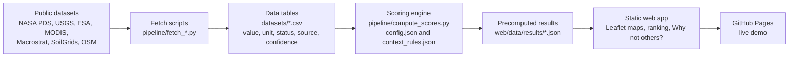
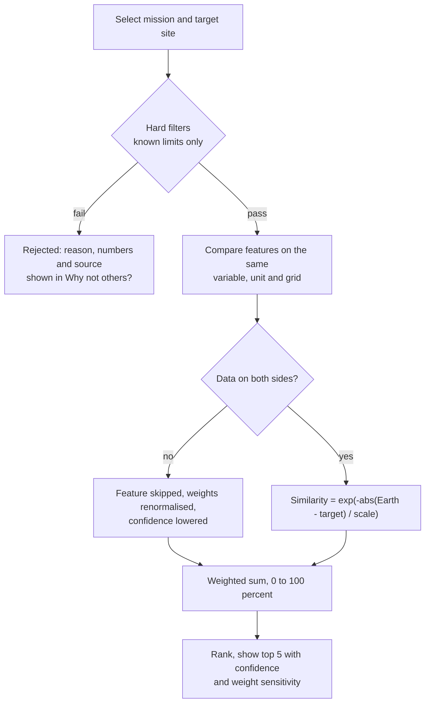
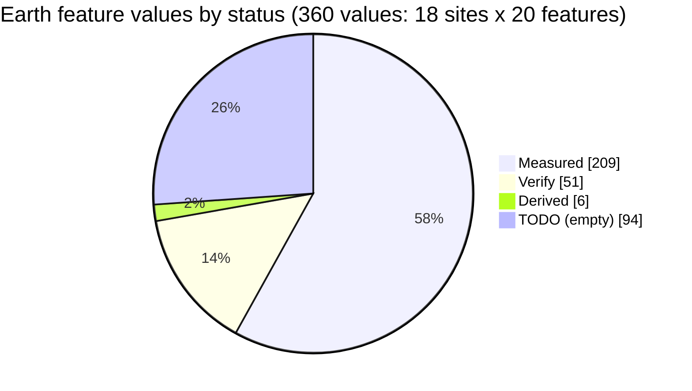
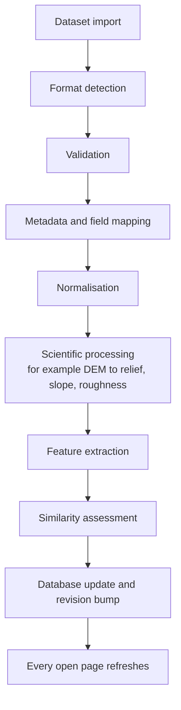

# EarthTwin

**Finding Earth's best analogs for the Moon and Mars, with the evidence behind every match.**

Team **PLANEX** | NASA International Space Apps Challenge 2026 | Challenge: *Identify Earth Locations that Analog the Permanent Moon Base Locations and Mars*

| | |
|---|---|
| **Live demo** | https://es-ratt.github.io/earthtwin/web/ |
| **Project report** | https://drive.google.com/drive/folders/1GjcM5qUCqWDgIbal3alG-kB1GQ4EiqtR?usp=sharing |
| **Source code** | https://github.com/es-ratt/earthtwin |
| **Challenge** | NASA Space Apps 2026, hackathon of 14-15 November 2026 |

EarthTwin is a decision-support web application for mission planners and analog-testing teams. The user picks an upcoming NASA mission, **Artemis IV** (Moon, south pole) or **SkyFall** (Mars), and a target site. EarthTwin ranks Earth locations by how closely they match that target on measured variables, and it explains, in plain language and with numbers, why every other location was rejected or ranked lower.

The aim is not to find places that look similar. It is to compare the **same variable, in the same unit, on the same grid** on both sides, and to show the uncertainty openly.

---

## Contents

1. [At a glance](#at-a-glance)
2. [What EarthTwin does](#what-earthtwin-does)
3. [How to use the live demo](#how-to-use-the-live-demo)
4. [System architecture](#system-architecture)
5. [How the Similarity Score works](#how-the-similarity-score-works)
6. [Data used](#data-used)
7. [Results snapshot](#results-snapshot)
8. [Honest limitations](#honest-limitations)
9. [Quick start](#quick-start)
10. [Repository layout](#repository-layout)
11. [Full application (Data Center edition)](#full-application-data-center-edition)
12. [Documentation](#documentation)
13. [Tech stack](#tech-stack)
14. [Sources and references](#sources-and-references)
15. [Roadmap and known gaps](#roadmap-and-known-gaps)
16. [Team PLANEX](#team-planex)
17. [Acknowledgments and disclaimer](#acknowledgments-and-disclaimer)

---

## At a glance

| Item | Value |
|---|---|
| Missions | Artemis IV (Moon, south pole) and SkyFall (Mars) |
| Target sites | 10 Moon targets (9 NASA candidate regions plus Shackleton Connecting Ridge) and 6 Mars targets (5 regions plus the AP-105 reference ellipse) |
| Earth candidate sites | 18 |
| Earth values stored | 360 (18 sites x 20 features), each with source, status and confidence |
| Target values stored | 86 (72 measured, 14 empty on purpose) |
| Datasets that supply scored values | 14 (NASA, USGS, ESA and open data) |
| Output per target | Top 5 Earth analogs with a Similarity Score from 0 to 100 percent |
| Rejected sites | Every one gets a "Why not others?" card (verdict, numbers, weakest features, what would change it) |
| Automated tests | 55 pipeline tests and 32 backend tests |
| Deployment | Static site on GitHub Pages, no backend, scores precomputed offline in Python |

---

## What EarthTwin does

- **Mission selector.** Choose Artemis IV or SkyFall. The maps, targets and weights change with the mission.
- **Linked maps.** The Moon or Mars target map (NASA Trek imagery) and the Earth map (NASA GIBS) are shown side by side.
- **Ranked analogs.** Each target gets its top five Earth sites with a Similarity Score. The score is not called "accuracy", because there is no ground truth for the Moon or Mars.
- **Feature-by-feature comparison.** Slope, roughness, temperature, ground ice, geology, light regime and access are shown as target-versus-Earth bars.
- **"Why not others?"** Each rejected or low-ranked site gets a card: the verdict, the reason type (hard-filter fail, low score or missing data), the numbers with units and sources, the three weakest features, what would change the result, and a confidence level.
- **Method, Limitations and Sources tabs.** The weights are shown and editable in a configuration file. Every limitation is stated, and every source is listed.
- **Transparent gaps.** A missing value is shown as "No data". It is never guessed, and it lowers the confidence indicator.

---

## How to use the live demo

1. Open https://es-ratt.github.io/earthtwin/web/ .
2. Start from the home page and select a mission: **Artemis IV** or **SkyFall**.
3. Pick a target site, for example Haworth (Moon) or AP-105 (Mars).
4. Read the ranked list of Earth analogs and open a site to see the feature comparison.
5. Open **Why not others?** to see why other sites were rejected.
6. Read the **Method**, **Limitations** and **Sources** tabs to see how the score is built and where it fails.

---

## System architecture

The hackathon version is a static site. All heavy computation runs offline in Python and ships as JSON.



Reproducibility: the same inputs always give the same scores. Re-running `pipeline/compute_scores.py` on the committed data reproduces the committed results exactly, apart from the timestamp.

---

## How the Similarity Score works

### Formula

```text
Score = sum over features i of  w_i * exp( -| Earth_i - Target_i | / scale_i )
```

- `exp(-d / scale)` gives 1.0 for a perfect match and about 0.37 when the difference equals the scale.
- Weights are set per mission and per category. A category's weight is split equally between that mission's features in the category.
- Only features with data on both sides are used. The weights of the remaining features are **renormalised in the open**, and the confidence indicator goes down.
- Categorical features (regolith type, geology type) use a team-defined similarity table. Pairs not listed score 0.

### Decision flow



### Mission weights (provisional team decisions, editable in `pipeline/config.json`)

| Category | Artemis IV (Moon) | SkyFall (Mars) |
|---|---|---|
| Terrain | 30% | 30% |
| Temperature | 15% | 15% |
| Light | 25% | 0% |
| Ice and subsurface | 10% | 30% |
| Logistics | 20% | 25% |

### Features compared

| Category | Artemis IV | SkyFall |
|---|---|---|
| Terrain | Slope and roughness on a 240 m grid, rock cover, regolith type, geology type | Slope and roughness on a 200 m grid, rock cover, regolith type, geology type |
| Temperature | Temperature swing, relative cold index | Temperature swing, thermal inertia |
| Light | Highest sun angle | Not used |
| Ice | Ground-ice presence and depth | Ground-ice presence and depth |
| Logistics | Access and communications index | Access and communications index |

Permanently shadowed region temperatures (below about 100 K, some near 40 K) do not exist on Earth. For Artemis IV, EarthTwin therefore matches relative cold, slope, roughness, light regime and ice presence, and states this limit in the app.

### Scales (provisional, `pipeline/config.json`)

| Feature | Scale |
|---|---|
| Slope (240 m and 200 m grids) | 5 degrees |
| Roughness | 5 m |
| Rock cover | 5 percent |
| Temperature swing | 20 K |
| Relative cold index | 0.3 |
| Thermal inertia | 300 (SI units) |
| Highest sun angle | 20 degrees |
| Ground-ice presence | 1.5 (ordinal 0 to 3) |
| Depth to ice | 2 m |
| Logistics index | 0.3 |

### Hard filters, confidence and sensitivity

- **Hard filters** use only limits that NASA has published, for example the SkyFall slope limit of 15 degrees. A limit that is unknown (such as the Artemis HLS slope limit) is stored as `null` with status `TODO` and is never applied.
- **Confidence** is high, medium or low and depends on data coverage and data status.
- **Sensitivity check** shows whether the ranking is stable when each weight changes by 10 percentage points. In several cases the top-ranked site is not stable, and the app says so.
- **Validation view** shows where well-known analogs, such as Haughton Crater, rank in the model.

---

## Data used

All terrain data are compared at the same scale on both sides. The Earth DEM is resampled to the grid of the target body before slope and roughness are computed.

| Dataset | Body | Resolution | Role | Link |
|---|---|---|---|---|
| LRO LOLA polar DEM (LDEM_75S_240M) | Moon | 240 m | Slope and roughness of lunar targets | https://pds-geosciences.wustl.edu/lro/lro-l-lola-3-rdr-v1/lrolol_1xxx/data/lola_gdr/polar/img/ldem_75s_240m.lbl |
| LRO Diviner Polar Resource Product | Moon | 0.5 km mesh | Temperature and ice-stability context | https://pds-geosciences.wustl.edu/lro/urn-nasa-pds-lro_diviner_derived1/data_derived_prp/ |
| USGS Unified Geologic Map of the Moon | Moon | 1:5,000,000 | Geologic unit at lunar targets | https://astrogeology.usgs.gov/search/map/Moon/Geology/Unified_Geologic_Map_of_the_Moon |
| Mars MOLA-HRSC blended DEM v2 (USGS) | Mars | 200 m | Slope and roughness of Mars targets | https://astrogeology.usgs.gov/search/map/mars_mgs_mola_mex_hrsc_blended_dem_global_200m |
| USGS Geologic Map of Mars (SIM 3292) | Mars | 1:20,000,000 | Geologic unit at Mars regions | https://pubs.usgs.gov/sim/3292/ |
| NASADEM HGT v001 | Earth | 30 m, 60N to 56S | Terrain of 11 Earth sites | https://planetarycomputer.microsoft.com/dataset/nasadem |
| Copernicus DEM GLO-30 (ESA) | Earth | 30 m, global | Terrain of 7 Earth sites (polar sites) | https://planetarycomputer.microsoft.com/dataset/cop-dem-glo-30 |
| MODIS MOD11A2 / MYD11A2 v061 | Earth | 1 km, 8-day | Temperature swing and relative cold | https://planetarycomputer.microsoft.com/dataset/modis-11A2-061 |
| ESA CCI Permafrost v5.0 | Earth | about 1 km | Ground-ice level and depth | https://catalogue.ceda.ac.uk/uuid/d235665772ec4b558e9a89ac85595e71 |
| Macrostrat geologic map API | Earth | map-scale dependent | Rock type | https://macrostrat.org/api/v2/geologic_units/map |
| ISRIC SoilGrids 2.0 | Earth | 250 m | Soil group, regolith category | https://rest.isric.org/soilgrids/v2.0/docs |
| USDA NRCS Soil Data Access | Earth (US) | SSURGO polygons | Soil data for US sites | https://sdmdataaccess.sc.egov.usda.gov/ |
| OurAirports | Earth | point list | Airport distance for logistics | https://ourairports.com/data/ |
| OpenStreetMap (Overpass API) | Earth | vector | Road access for logistics | https://overpass-api.de/ |

Supporting sources: NASA Moon Trek and Mars Trek (basemaps), NASA GIBS (Earth basemap), LROC NAC mosaics and the USGS Planetary Gazetteer (target positions), USGS GNIS, the Smithsonian Global Volcanism Program and Wikidata (Earth coordinate checks), and the NASA SkyFall Mission Information Package (engineering limits). The complete register of 121 sources, with a kind and confidence for each, is in `web/data/sources.json` and on the app's Sources tab.

### Provenance and data status

Every stored value carries its dataset, product ID, version, date range, resolution, processing method, source URL, status and confidence. Status has four values:

| Status | Meaning |
|---|---|
| `measured` | Taken from a dataset, or computed directly from one |
| `derived` | Calculated by the pipeline from other stored values |
| `verify` | Needs a second person to check it (for example modelled ice or a provisional category mapping) |
| `TODO` | No value yet. Shown as "No data", never guessed |



Target values: 72 measured and 14 empty (86 in total). NASA and USGS sources are kept separate from third-party sources in the data and in the app.

### Deliberately empty

| Item | Reason |
|---|---|
| Earth rock cover | No Earth dataset gives rock abundance in the same unit as the Moon and Mars. Proxies are not in percent. |
| Earth thermal inertia | Earth has only an apparent thermal inertia proxy in a different unit, which needs an Earthdata login and a calibrated model. |
| Lunar temperature swing | The Diviner Polar Resource Product has no minimum temperature. |
| Slater Plain position | No source gives a region centre. |
| Arcadia, Utopia and Phlegra slope and roughness | The sampling boxes inside 30N to 45N are not decided yet. |
| Logistics for 12 of 18 Earth sites | The OpenStreetMap server did not respond in time. |

Products that need a NASA Earthdata login (ASTER GDEM v3, NSIDC GGD318, SEDAC gROADS, VIIRS Black Marble and the ATI proxy) are listed with steps in [README_DATA.md](README_DATA.md) and are not counted as data used.

---

## Results snapshot

These are the top three Earth analogs for one reference target per mission, from the committed results in `web/data/results/`. The app shows the top five for every target.

| Mission and target | Rank 1 | Rank 2 | Rank 3 |
|---|---|---|---|
| SkyFall, AP-105 (Arcadia Planitia) | Duvanny Yar, 80% | Svalbard Bockfjorden, 62% | Nain, 58% |
| Artemis IV, Haworth | Beacon Valley, 45% | Haughton Crater, 39% | Axel Heiberg, 37% |

How to read these numbers: the Similarity Score is a relative ranking on the features that have data on both sides. It is not a probability of mission success. Most confidence levels are low, and for some targets the top pick changes when the weights move by 10 percentage points. The app reports both.

---

## Honest limitations

Earth cannot reproduce several conditions of the Moon and Mars. EarthTwin states where each analog works, how well, and where it fails.

- **Lunar gravity.** The Moon has 0.16 g, so mobility and landing tests on Earth are only partial.
- **Vacuum and radiation.** Earth has no hard vacuum and no deep-space radiation. Shelters and electronics cannot be tested outdoors.
- **Permanently shadowed temperatures.** Temperatures below about 100 K do not exist on Earth.
- **Mars atmosphere.** Earth has a far denser atmosphere than Mars.
- **Proxies.** Earth rock cover and thermal inertia are left empty because no same-unit dataset exists.
- **Scale.** The grids are 240 m and 200 m. They describe regional terrain, not the exact touchdown spot. NASA's SkyFall slope limit is defined at 1 to 5 m.
- **Provisional method.** Weights, scales and category mappings are team decisions pending review by planetary scientists.
- **Modelled ice.** Earth ground-ice values come from a modelled 1 km product, not a ground survey.

---

## Quick start

### Static hackathon prototype (`web/` and `pipeline/`)

```bash
python3 -m venv .venv && source .venv/bin/activate
pip install -r requirements-dev.txt

# Optional: refresh the data (no login needed)
.venv/bin/python pipeline/fetch_context_data.py coords   # check Earth coordinates first
.venv/bin/python pipeline/fetch_real_data.py all         # terrain (Moon, Mars, Earth) and MODIS temperature
.venv/bin/python pipeline/fetch_context_data.py all      # soil, rock type, permafrost, logistics

# Recompute scores and run the app
python3 pipeline/compute_scores.py                       # writes web/data/results/
cd web && python3 -m http.server 8000                    # open http://localhost:8000
```

Edit the weights, scales and category tables in `pipeline/config.json`, re-run `compute_scores.py`, and the app shows the new values.

### Tests

```bash
python -m pytest pipeline/tests -q -c pipeline/pytest.ini   # 55 pipeline tests
cd backend && python -m pytest -q                            # 32 backend tests
```

### Deployment

`.github/workflows/pages.yml` publishes `web/` to GitHub Pages. See [docs/DEPLOYMENT.md](docs/DEPLOYMENT.md).

---

## Repository layout

```text
web/                    Static hackathon app (published to GitHub Pages)
  index.html, css/, js/, fonts/, img/, vendor/
  js/                   app.js, nav.js, pages.js, panels.js, maps.js, layers.js, tiles-check.js,
                        solar.js, solar-art.js, backdrop.js, util.js
  data/                 missions, targets, features, limitations, sources, worlds, earth_candidates,
                        coordinate_verification, results/{artemis-iv,skyfall}.json
pipeline/               Offline data and scoring (Python)
  fetch_real_data.py, fetch_context_data.py, fetch_earthdata.py, fetch_target_context.py,
  extract_features.py, compute_scores.py, common.py
  config.json           weights, scales, categorical similarity (team decisions)
  context_rules.json    soil, geology and ice rules (provisional)
  tests/                55 tests
datasets/               earth_candidates.csv, earth_features.csv, target_measurements.csv,
                        coordinate_sources.csv, coordinate_verification.csv
docs/                   METHODOLOGY, DATA_PLAN, DATA_DICTIONARY, MISSING_DATA,
                        IMPLEMENTATION_STATUS, API, DEPLOYMENT
backend/ and frontend/  Full application with Data Center (FastAPI, SQLite)
templates/              Import templates (CSV, GeoJSON, bundle)
legacy/prototype.html   Original single-file prototype, kept for reference
README_DATA.md          Data still needed and how to add it
```

---

## Full application (Data Center edition)

Besides the static prototype, the repository contains a full application. It compares Earth locations with lunar and Martian target regions, and lets the team add NASA, ESA, USGS or other verified datasets through a Data Center, with no code changes or rebuilds.

> **Demonstration data.** The full application ships with a curated catalogue (17 Earth sites, 9 Moon and Mars targets) and illustrative placeholder measurements, all labelled **DEMO DATA, NOT A VERIFIED SCIENTIFIC RESULT**. Results become scientific only after verified datasets are imported. The static prototype above uses real data and has no sample values left. See [docs/IMPLEMENTATION_STATUS.md](docs/IMPLEMENTATION_STATUS.md).

### Quick start

```bash
git clone https://github.com/es-ratt/earthtwin.git && cd earthtwin
python3 -m venv .venv && source .venv/bin/activate      # Python 3.11+ (tested on 3.13)
pip install -r requirements-dev.txt
python run.py                                            # http://127.0.0.1:8000
```

The first start creates `data/`, applies database migrations, imports the seed bundles through the normal import pipeline, and prints the Data Center admin token.

### Pages

| Page | What it does |
|---|---|
| Home | Mission, challenge statement, how analog comparison works, live data-transparency counts |
| Explorer | Choose a Moon or Mars target and a weighting profile, and filter candidates. The map, ranking and evidence panel stay in sync |
| Targets | Moon and Mars explorers on their own planetocentric maps (NASA Trek imagery), with search and target profiles |
| Catalogue | Searchable Earth analog catalogue by category, with data-completeness indicators |
| Site profile | Context, every measurement with source, method and class, similarity breakdown, differences, applications, citations |
| Compare | Up to three sites against one target: dot plot, contribution bars, metrics table, CSV and PDF export |
| Data Center | Dataset catalogue, upload, inspect, field mapping, validation report, processing log, activation, versions, templates, NASA CMR search |
| Reports | Candidate CSV, comparison CSV, PDF scientific report |
| Methodology | Criteria, formulas, weights, missing-data rules, coordinate handling, limitations, sources |
| About | Purpose, approach, acknowledgments, independence statement |

### Import pipeline



- **Similarity engine** (`backend/app/services/similarity.py`): per-criterion similarity (Gaussian, log-ratio, Jaccard, agreement), a weight-normalised index, coverage reported separately, "Insufficient data" below a threshold, and the input data classes carried through. Missing data are never treated as matches.
- **Planetary-aware:** Earth uses WGS 84. The Moon and Mars use planetocentric, east-positive coordinates on IAU 2015 spheres. Longitude conventions and latitude types must be declared on import, and raster coordinate systems are checked against the declared body.
- **Provenance:** every value has its dataset, version, method, spatial support and class (`verified`, `derived` or `demo`).

### Adding your datasets

1. Open **Data Center**, enter the admin token, and choose **Import data**.
2. Upload a CSV, JSON, GeoJSON, GeoTIFF or bundle (templates are under *Formats and templates*).
3. Pick what it contains, review the proposed field mapping, and confirm units and coordinate conventions.
4. Fill in provenance. Verified data need a publisher and a source URL or identifier, plus the citation.
5. **Validate** (a dry run with a full report), then **Process**. The dataset is versioned and activated, and every page updates.
6. When verified data cover your needs, deactivate *EarthTwin demonstration measurements*.

New kinds of measurement need a variable definition (and optionally a criterion) in `backend/app/services/vocabulary.py`. New file types or processing need an adapter in `backend/app/ingest/adapters/`. See [docs/DATA_DICTIONARY.md](docs/DATA_DICTIONARY.md).

---

## Documentation

| Document | Content |
|---|---|
| [docs/METHODOLOGY.md](docs/METHODOLOGY.md) | Scoring method (full version in the app) |
| [docs/DATA_PLAN.md](docs/DATA_PLAN.md) | Data plan and datasets |
| [docs/DATA_DICTIONARY.md](docs/DATA_DICTIONARY.md) | Data dictionary and import formats |
| [docs/MISSING_DATA.md](docs/MISSING_DATA.md) | Missing data, conflicts found and team decisions |
| [docs/IMPLEMENTATION_STATUS.md](docs/IMPLEMENTATION_STATUS.md) | Implementation status, tests and limitations |
| [docs/API.md](docs/API.md) | API (interactive at `/api/docs` in the full application) |
| [docs/DEPLOYMENT.md](docs/DEPLOYMENT.md) | Local, Docker and hosted deployment |
| [README_DATA.md](README_DATA.md) | Data still needed and how to add it |

---

## Tech stack

| Layer | Tools |
|---|---|
| Static app | Vanilla JavaScript modules, Leaflet 1.9.4 (vendored), inline SVG charts, no build step |
| Pipeline | Python (standard library for scoring; numpy, rasterio and pyproj for terrain processing), pytest |
| Full application | Python, FastAPI, SQLite, rasterio, pyproj, numpy, reportlab |
| Hosting | GitHub Pages (static app), Docker and Render configuration (full application) |
| Development | Built with the help of Claude (Anthropic) for code and documentation. The team set the missions, features, weights and rules, and every scientific value comes from a named dataset. |

---

## Sources and references

### NASA and USGS data and missions

- NASA SkyFall Mission Information Package (Sep 2026): https://science.nasa.gov/wp-content/uploads/2026/09/skyfall-mission-information-package-final.pdf
- NASA SkyFall: https://science.nasa.gov/mission/skyfall/
- NASA Artemis III regions update (28 Oct 2024): https://www.nasa.gov/news-release/nasa-provides-update-on-artemis-iii-moon-landing-regions/
- NASA Artemis IV: https://www.nasa.gov/mission/artemis-iv/
- NASA Moon Base Phases: https://www.nasa.gov/moonbase-phases/
- Lunar Reconnaissance Orbiter: https://science.nasa.gov/mission/lro/
- NASA Planetary Data System: https://pds.nasa.gov/
- USGS Astrogeology: https://planetarymaps.usgs.gov/
- USGS Planetary Gazetteer: https://planetarynames.wr.usgs.gov/
- NASA Moon Trek: https://trek.nasa.gov/moon/ and Mars Trek: https://trek.nasa.gov/mars/
- NASA GIBS: https://nasa-gibs.github.io/gibs-api-docs/
- NASA Earthdata Search: https://search.earthdata.nasa.gov

### Research papers and abstracts

- Hayne et al. 2015, Diviner temperatures and ice: https://luna1.diviner.ucla.edu/~dap/pubs/074.pdf
- Tye et al. 2015, crater ages (NASA NTRS): https://ntrs.nasa.gov/citations/20150006822
- Wueller et al. 2026, Artemis landing sites (JGR Planets): https://agupubs.onlinelibrary.wiley.com/doi/10.1029/2025JE009434
- Mahanti et al. 2024, secondary illumination in permanently shadowed regions: https://iopscience.iop.org/article/10.3847/PSJ/ad1b50
- Rice et al. 2023, de Gerlache Rim 2: https://www.hou.usra.edu/meetings/Artemis_III_2023/pdf/2009.pdf
- Pena-Asensio et al. 2024, multi-criteria site analysis: https://www.sciencedirect.com/science/article/pii/S0094576524006234
- Glaser et al. 2014, illumination: https://elib.dlr.de/94242
- Basilevsky 2024, Haworth floor craters: https://www.hou.usra.edu/meetings/lpsc2024/pdf/1790.pdf
- Mars ice and SHARAD radar: SWIM project, https://swim.psi.edu

### Open and non-NASA data

- Microsoft Planetary Computer (access to NASADEM, Copernicus DEM and MODIS): https://planetarycomputer.microsoft.com
- ISRIC SoilGrids: https://rest.isric.org/soilgrids/v2.0/docs
- Macrostrat: https://macrostrat.org
- OpenStreetMap: https://www.openstreetmap.org
- OurAirports: https://ourairports.com/data/
- Natural Earth: https://www.naturalearthdata.com

The full register of 121 sources, with the kind of each (NASA or USGS, research paper, third-party), is in [`web/data/sources.json`](web/data/sources.json). Third-party sources such as news and Wikipedia are labelled and are not used for scored values.

---

## Roadmap and known gaps

| Area | Status |
|---|---|
| Slater Plain position | Needs a source for the region centre |
| Mars sampling boxes (Arcadia, Utopia, Phlegra) | Team decision pending |
| Lunar temperature swing | Needs the Diviner seasonal polar product |
| Logistics for 12 Earth sites | Re-run when OpenStreetMap recovers, or use NASA SEDAC gROADS (login) |
| Earth thermal inertia and ASTER, NSIDC data | Need a NASA Earthdata login |
| Artemis HLS slope limit | Needs a NASA source |
| Weights, scales and category mappings | Need review by planetary scientists |
| Moon Base mission profiles | Schema allows adding them later |

Details and the decisions made are in [docs/MISSING_DATA.md](docs/MISSING_DATA.md).

---

## Team PLANEX

| Name | Role |
|---|---|
| Most. Esrat Jhahan Nur | Team Leader |
| Sharmin Sultana | Researcher |
| Md. Rezwanul Islam | Data Scientist |
| Tasnem Rahman | Video Editor, Presenter and Storyteller |
| Nobin Uddin Alif | Developer |

---

## Acknowledgments and disclaimer

Imagery: NASA Solar System Treks (LRO WAC, LRO LOLA, Viking MDIM 2.1, MGS MOLA) and NASA GIBS Blue Marble. Land outlines: Natural Earth. Metadata search: NASA CMR. Mapping: Leaflet (BSD-2-Clause). Data hosting: Microsoft Planetary Computer.

**Disclaimer.** EarthTwin is an independent project created for the NASA Space Apps Challenge. It is not affiliated with or endorsed by NASA. Similarity scores are relative rankings from a prototype method. They are not probabilities of mission success or proof of environmental equivalence.